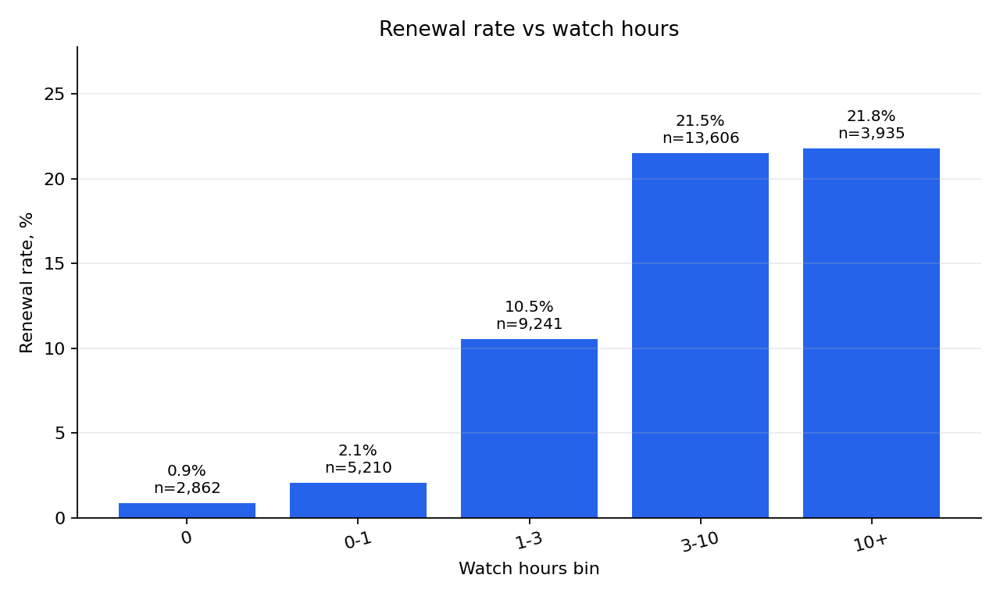
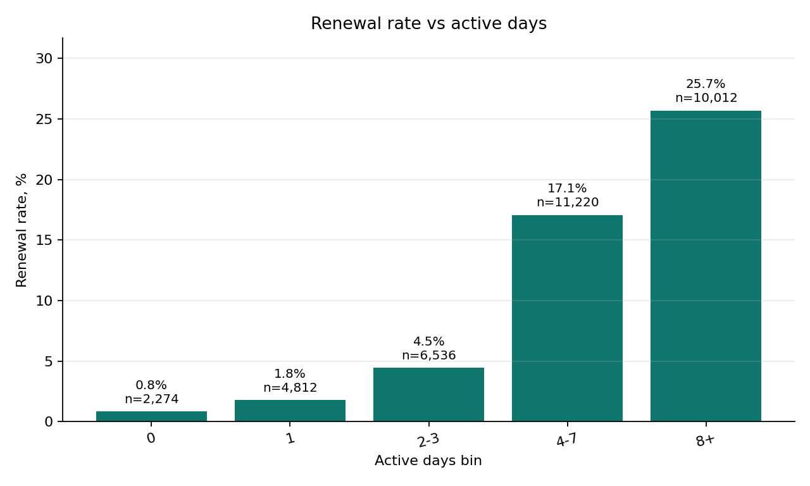
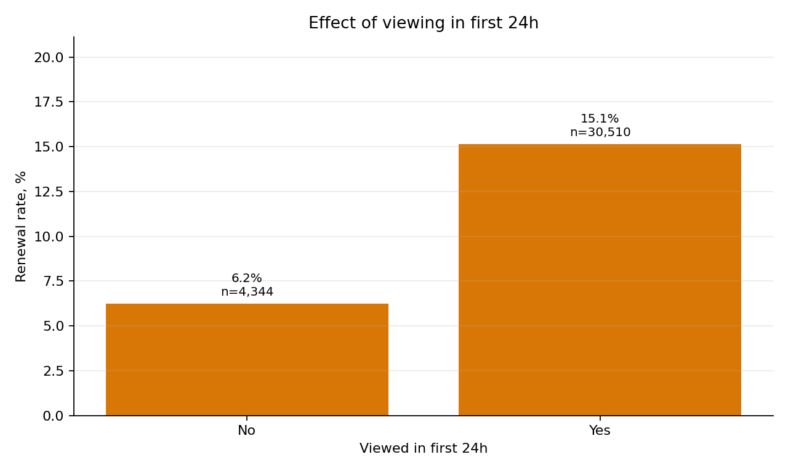
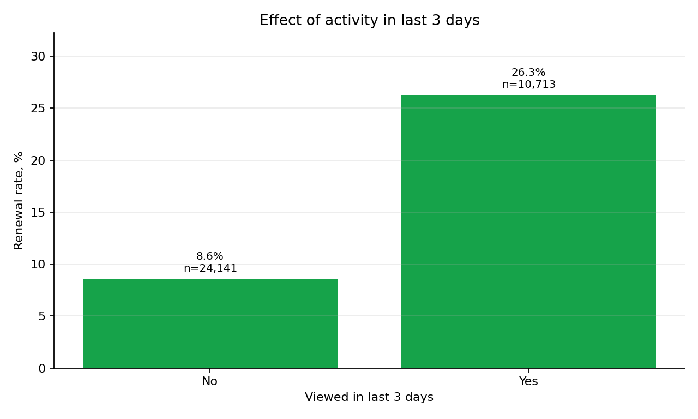
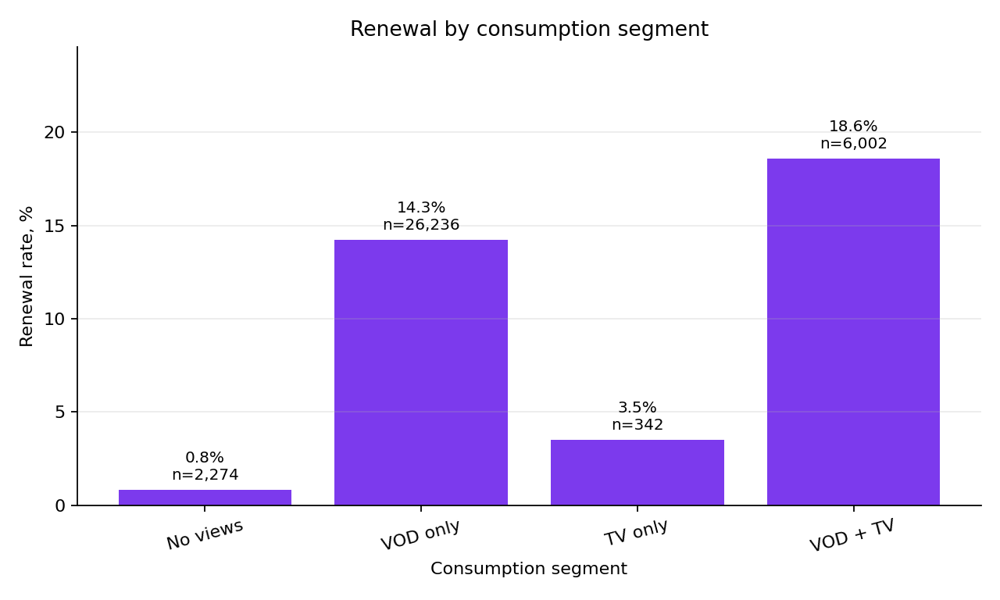
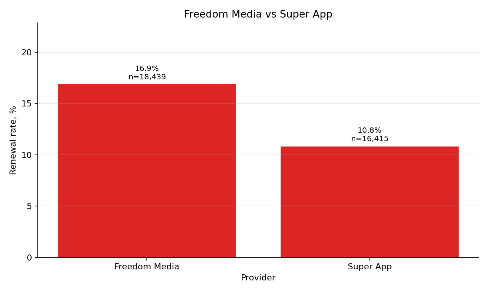
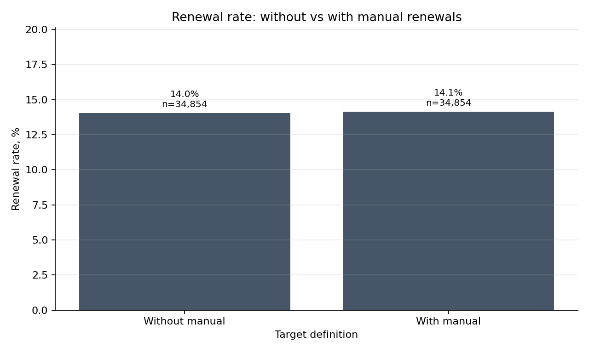

# First Subscription Renewal: May 2026 Cohort

## Методология

Дата отчета: `2026-07-03`.

Цель исследования: понять, какие паттерны потребления контента во время первой подписки связаны с продлением в течение 7 дней после окончания первой подписки.

Когорта: пользователи, у которых первая валидная подписка началась в период `[2026-05-01; 2026-05-31]`.

Базовая таблица подписок: `spark_dm.subscriptions_with_revenue`.

Почему используем `spark_dm.subscriptions_with_revenue`:

- витрина фильтрует тестовых пользователей и служебные пакеты;
- содержит нормализованный `provider_id`;
- содержит `payment_status`, который позволяет отделить ручные подписки от реальных оплат;
- подходит для анализа Freedom Media и Super App без смешивания с тестовыми и ручными продлениями.

Базовые фильтры:

- `provider_id in (1, 8)`;
- `payment_status <> 'manual'`;
- `user_id is not null`;
- `start_date is not null`;
- `end_date is not null`;
- `duration > 0`;
- `first_sub_end + 7 <= current_date`.

`renewed_7d = 1`, если у пользователя есть следующая НЕ ручная подписка в течение 7 дней после окончания первой подписки:

```sql
next.start_date > first_sub_end
and next.start_date <= first_sub_end + 7
and next.payment_status <> 'manual'
```

`manual_renewed_7d = 1`, если в том же 7-дневном окне есть ручная следующая подписка (`payment_status = 'manual'`). Этот флаг используется только для диагностики и не смешивается с основным `renewed_7d`.

Все цифры ниже получены через read-only SQL в `fmedia_gp`. Сырые события, списки `user_id`, `phone`, IP и device id не выгружались.

## Data Checks

| Метрика | Значение |
|---|---:|
| Кандидатов до проверки полного окна | 44 235 |
| Исключено из-за неполного окна наблюдения | 9 381 |
| Пользователей в финальной когорте | 34 854 |
| Диапазон `first_sub_start` после фильтров | 2026-05-01 - 2026-05-30 |
| Максимальный `first_sub_end` после фильтров | 2026-06-26 |
| `renewed_7d` rate без manual | 14.02% |
| `manual_renewed_7d` rate | 0.11% |
| `renewed_7d` rate с учетом manual | 14.14% |
| Средний `total_watch_hours` | 5.02 |
| Средний `active_days` | 5.63 |
| Средний `sessions_cnt` | 31.01 |
| Средний `distinct_titles` | 7.86 |
| Средний `distinct_genres` | 1.80 |
| Доля `viewed_first_24h` | 87.54% |
| Доля `viewed_last_3d` | 30.74% |
| Доля `has_tv` | 18.20% |

### Provider Distribution

| Provider | Users | Renewal Rate | Manual Renewal Rate | Renewal Rate With Manual |
|---|---:|---:|---:|---:|
| Freedom Media | 18 439 | 16.87% | 0.08% | 16.94% |
| Super App | 16 415 | 10.83% | 0.16% | 10.98% |

### Payment Status

| Payment Status | Users | Renewal Rate | Manual Renewal Rate | Renewal Rate With Manual |
|---|---:|---:|---:|---:|
| `promo/trial` | 34 283 | 14.13% | 0.11% | 14.23% |
| `full_price` | 571 | 7.53% | 0.70% | 8.23% |

`manual` отсутствует в основной когорте, потому что исключен базовым фильтром.

### Subscription Type

| Subscription Type | Users | Renewal Rate | Manual Renewal Rate | Renewal Rate With Manual |
|---|---:|---:|---:|---:|
| Триальный период | 27 722 | 16.56% | 0.13% | 16.69% |
| Промокод | 6 561 | 3.84% | 0.00% | 3.84% |
| Платная | 571 | 7.53% | 0.70% | 8.23% |

## Manual Subscriptions Diagnostics

| Метрика | Total | Freedom Media | Super App |
|---|---:|---:|---:|
| Ручные первые подписки, исключенные из когорты | 2 604 | 21 | 2 583 |
| Пользователи с ручной следующей подпиской в 7-дневном окне | 40 | 14 | 26 |
| `renewed_7d` без manual | 14.02% | 16.87% | 10.83% |
| `renewed_7d` с manual | 14.14% | 16.94% | 10.98% |
| Изменение от учета manual | +0.11 п.п. | +0.08 п.п. | +0.16 п.п. |

Главный эффект manual находится не в целевой переменной текущей когорты, а в исключении первых подписок: 2 583 из 2 604 ручных первых подписок относятся к Super App. Это подтверждает, что Super App нужно анализировать отдельно и не смешивать ручные подписки с реальным продлением.

## Binning

### Watch Hours



| Watch Hours | Users | Renewal Rate |
|---|---:|---:|
| 0 | 2 862 | 0.87% |
| 0-1 | 5 210 | 2.07% |
| 1-3 | 9 241 | 10.52% |
| 3-10 | 13 606 | 21.50% |
| 10+ | 3 935 | 21.78% |

### Active Days



| Active Days | Users | Renewal Rate |
|---|---:|---:|
| 0 | 2 274 | 0.84% |
| 1 | 4 812 | 1.81% |
| 2-3 | 6 536 | 4.47% |
| 4-7 | 11 220 | 17.08% |
| 8+ | 10 012 | 25.70% |

## Charts

### Viewed First 24h



| Viewed First 24h | Users | Renewal Rate |
|---|---:|---:|
| No | 4 344 | 6.24% |
| Yes | 30 510 | 15.13% |

### Viewed Last 3 Days



| Viewed Last 3d | Users | Renewal Rate |
|---|---:|---:|
| No | 24 141 | 8.59% |
| Yes | 10 713 | 26.27% |

### Consumption Segment



| Segment | Users | Renewal Rate |
|---|---:|---:|
| No views | 2 274 | 0.84% |
| VOD only | 26 236 | 14.26% |
| TV only | 342 | 3.51% |
| VOD + TV | 6 002 | 18.59% |

### Freedom Media vs Super App



| Segment | Users | Renewal Rate |
|---|---:|---:|
| Freedom Media | 18 439 | 16.87% |
| Super App | 16 415 | 10.83% |

### Manual Diagnostics



| Target Definition | Users | Renewal Rate |
|---|---:|---:|
| Without manual | 34 854 | 14.02% |
| With manual | 34 854 | 14.14% |

## Summary Tables

### Watch Hours

| Сегмент | Users | Renewal Rate |
|---|---:|---:|
| 0 | 2 862 | 0.87% |
| 0-1 | 5 210 | 2.07% |
| 1-3 | 9 241 | 10.52% |
| 3-10 | 13 606 | 21.50% |
| 10+ | 3 935 | 21.78% |

### Active Days

| Сегмент | Users | Renewal Rate |
|---|---:|---:|
| 0 | 2 274 | 0.84% |
| 1 | 4 812 | 1.81% |
| 2-3 | 6 536 | 4.47% |
| 4-7 | 11 220 | 17.08% |
| 8+ | 10 012 | 25.70% |

### Engagement Flags

| Сегмент | Users | Renewal Rate |
|---|---:|---:|
| No first 24h view | 4 344 | 6.24% |
| First 24h view | 30 510 | 15.13% |
| No last 3d view | 24 141 | 8.59% |
| Last 3d view | 10 713 | 26.27% |

### Consumption

| Сегмент | Users | Renewal Rate |
|---|---:|---:|
| No views | 2 274 | 0.84% |
| VOD only | 26 236 | 14.26% |
| TV only | 342 | 3.51% |
| VOD + TV | 6 002 | 18.59% |

### Provider

| Сегмент | Users | Renewal Rate |
|---|---:|---:|
| Freedom Media | 18 439 | 16.87% |
| Super App | 16 415 | 10.83% |

### Subscription Type

| Сегмент | Users | Renewal Rate |
|---|---:|---:|
| Триальный период | 27 722 | 16.56% |
| Промокод | 6 561 | 3.84% |
| Платная | 571 | 7.53% |

## Findings

- Пользователи с `10+` часами просмотра имеют 21.78% вероятность продления. Это на +20.91 п.п. выше, чем у пользователей с 0 часов просмотра (0.87%).
- Пользователи с `8+` активными днями имеют 25.70% вероятность продления. Это на +24.86 п.п. выше, чем у пользователей с 0 активных дней (0.84%).
- Просмотр в первые 24 часа связан с 15.13% продления против 6.24% без просмотра в первые 24 часа: разница +8.89 п.п.
- Активность в последние 3 дня связана с 26.27% продления против 8.59% без активности в конце подписки: разница +17.68 п.п.
- `VOD + TV` имеет 18.59% продления против 14.26% у `VOD only`: разница +4.34 п.п.
- `No views` после исключения manual больше не выглядит аномально: renewal rate = 0.84%. Это исправляет прежнюю проблему, когда ручные/тестовые/неподходящие подписки создавали высокий renewal при нулевых просмотрах.
- Самый сильный поведенческий фактор в текущих срезах - регулярность и поздняя активность: `8+` active days и `viewed_last_3d`.
- Самый сильный неповеденческий разрез - провайдер: Freedom Media = 16.87%, Super App = 10.83%.
- Учет ручных следующих подписок почти не меняет основной target: 14.02% без manual против 14.14% с manual. Но ручные первые подписки сильно сконцентрированы в Super App: 2 583 из 2 604 исключенных manual first subscriptions.

## Product Implications

- Если пользователь не посмотрел в первые 24 часа, нужен ранний триггер: рекомендации, пуш, подборка "начать смотреть сейчас". В этом сегменте renewal rate = 6.24% против 15.13% у тех, кто посмотрел в первые 24 часа.
- Если у пользователя низкий `active_days`, стоит стимулировать регулярность, а не только общий watch time: 0-1 активный день дает 0.84-1.81% продления, а 8+ дней - 25.70%.
- Если пользователь не активен в последние 3 дня подписки, нужен end-of-period триггер: продолжить сериал, напомнить о недосмотренном, показать live-события или персональную подборку. Активность в последние 3 дня связана с +17.68 п.п. renewal.
- Если пользователь смотрит только VOD, можно тестировать аккуратное предложение live-контента: `VOD + TV` выше `VOD only` на +4.34 п.п.
- Для Super App нужно отдельно учитывать проблему manual/recurrent payments: в основной target manual исключены, но manual first subscriptions почти полностью приходят из Super App.
- Promo-сегмент требует отдельной конверсионной механики: renewal rate промокодов 3.84%, заметно ниже trial 16.56%.

## Notes for Next Iteration

- Повторить эти же срезы отдельно для Freedom Media и Super App.
- Проверить эффект `active_days` и `viewed_last_3d` внутри trial/promo/full_price, чтобы отделить поведение от типа подписки.
- Добавить контролируемую модель `renewed_7d ~ active_days + total_watch_hours + viewed_last_3d + provider_id + subscription_type + packet_id`.
